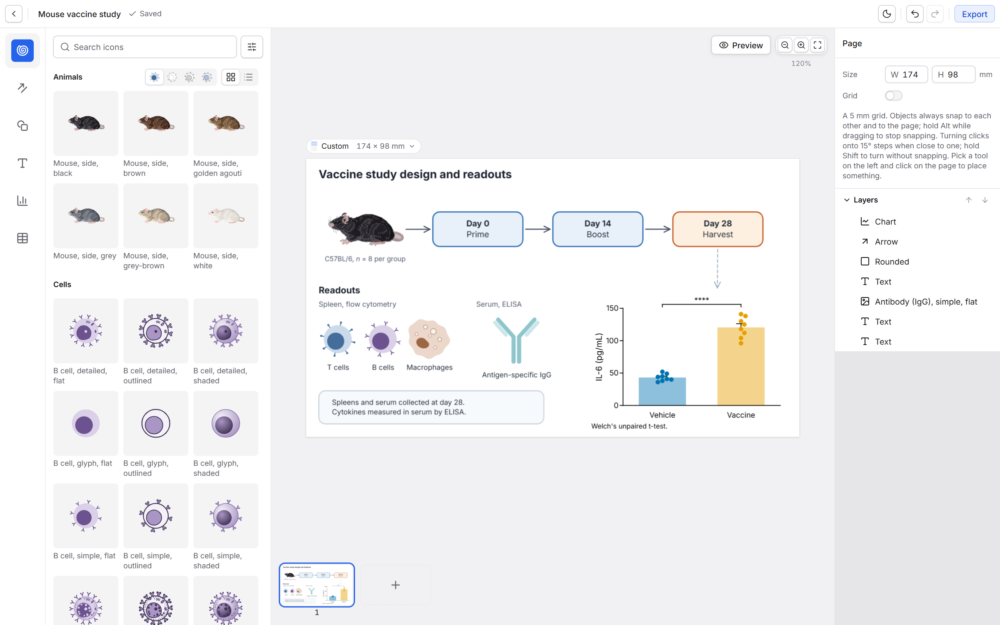

<h1> BioFigure Lab</h1>

**A free, open-source figure editor for the life sciences.**

BioFigure Lab helps you make scientific figures for papers, posters, slides and courses. Import your data to create publication-ready charts with error bars, statistical tests and significance brackets. Choose from a library of hundreds of scientific icons in several styles. Preview your figure on a journal page at actual size, and export it as SVG, PDF or PNG.

It runs in your browser and doesn't require an account. Use it at [biofigurelab.com](https://biofigurelab.com/app/), or run your own copy from this repository.

[Open the editor](https://biofigurelab.com/app/) · [Website](https://biofigurelab.com/) · [Icon licence](ICON-LICENSE.md)



> [!IMPORTANT]
> **The icon library isn't included in this repository.** It's a separate download with its own [licence](ICON-LICENSE.md). Follow step 3 below to download it. Without it, the editor still works, but the icon panel will be empty.

## Getting started

You need [Git](https://git-scm.com/downloads) and [Node.js 24](https://nodejs.org/) installed.

**1. Clone the repository**

```sh
git clone https://github.com/NolenBrolen/BioFigure-Lab.git
cd BioFigure-Lab
```

**2. Install the dependencies**

The second line is optional. It runs the type checks, lint and tests.

```sh
npm ci
npm run check
```

**3. Download the icon library**

This downloads the latest icon library into the `icons/` folder. We're still adding new icons, so run it again whenever you want the newest ones.

```sh
npm run icons
```

**4. Start the editor**

Run this command, then open [localhost:5180/app/](http://localhost:5180/app/) in your browser.

```sh
npm run dev -w apps/editor
```

**5. Host your own copy** (optional)

You may host BioFigure Lab for yourself, your organisation or the public, under the terms of the [icon licence](ICON-LICENSE.md).

Build the editor, then serve the `apps/editor/dist/` folder at `/app/` on your site.

```sh
npm run build -w apps/editor
```

## Project layout

- [`apps/editor`](apps/editor/): the figure editor
- [`apps/api`](apps/api/): optional server part (Cloudflare Worker)
- [`packages/ui`](packages/ui/): interface components
- [`packages/export`](packages/export/): SVG, PNG and PDF exporters
- `icons/`: the icon library, after you download it in step 3

## Licences

| What | Licence |
| --- | --- |
| Everything in this repository, except the exporters | [AGPL-3.0-or-later](LICENSE) |
| Exporters (`packages/export`) | [MIT](packages/export/LICENSE) |
| Icon library (separate download) | [BioFigure Lab Icon Library Licence](ICON-LICENSE.md) |

You can use and adapt the icons in figures for papers, posters, talks, courses and commercial work. You can credit BioFigure Lab, but you're not required to.

## Roadmap

<table>
<tr>
<td valign="top">

**Editor**
- [x] Graphs with error bars
- [x] Tables
- [x] Connected arrows
- [x] Multiple slides
- [x] Scientific text formatting
- [x] Journal-size preview
- [x] SVG, PDF and PNG export
- [x] Colour-blind-safe palettes
- [x] Mobile UI
- [ ] Icon text labels
- [ ] Upload your own images
- [ ] Figure templates
- [ ] Example figures
- [ ] More graph types
- [ ] More languages

</td>
<td valign="top">

**Accounts and working together**
- [ ] Sign-in
- [ ] Sync across devices
- [ ] Share links
- [ ] Share with people

**Icon library**
- [x] Recolourable icons
- [x] Pencil-style icons
- [ ] Lab equipment icons
- [ ] Cell and culture icons
- [ ] Membrane and molecule icons

**For developers and AI tools**
- [ ] API and MCP server

</td>
</tr>
</table>

## Feedback

Found a bug or have an idea? [Open an issue](../../issues).
